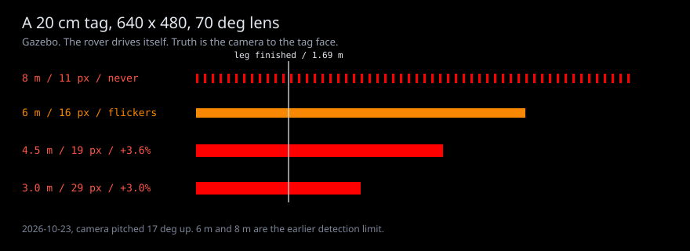
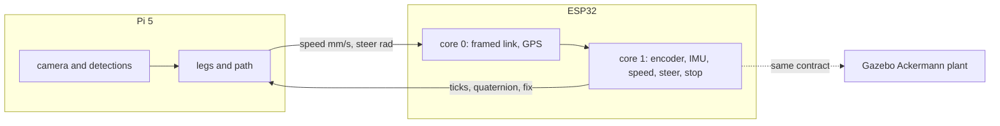
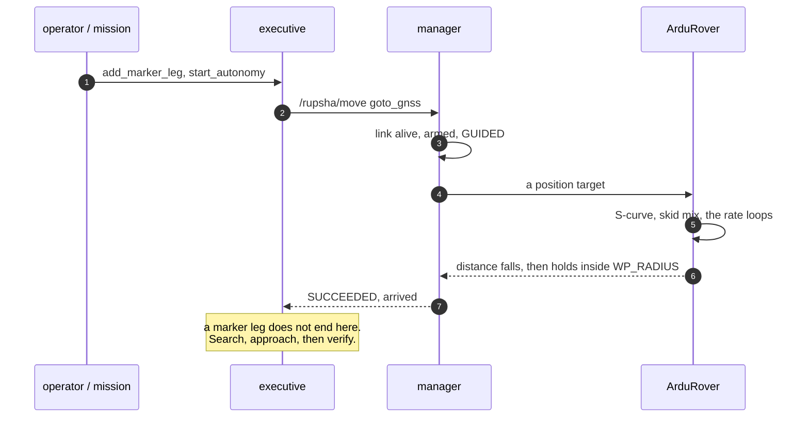
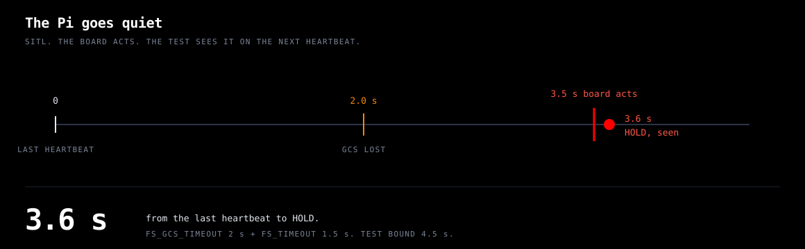
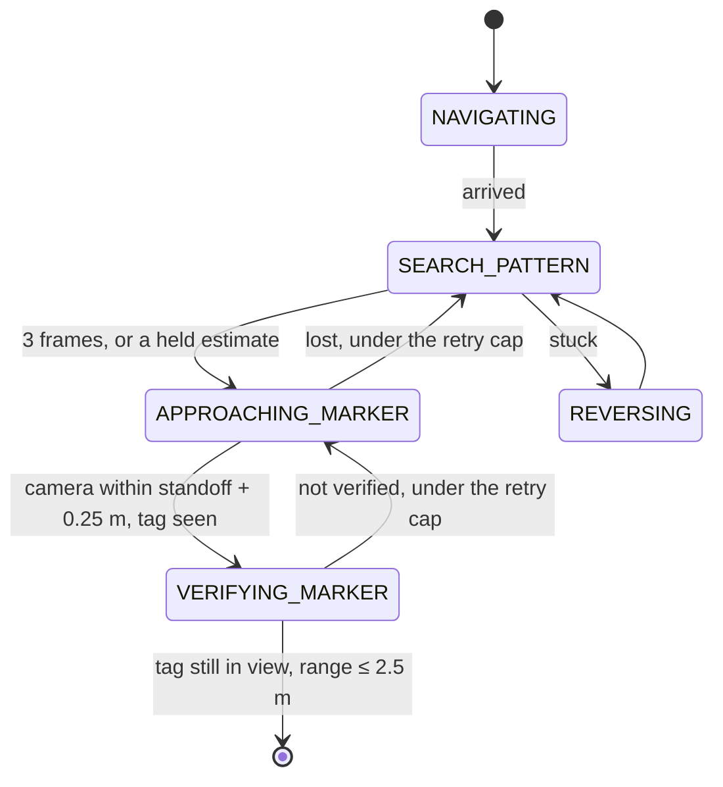
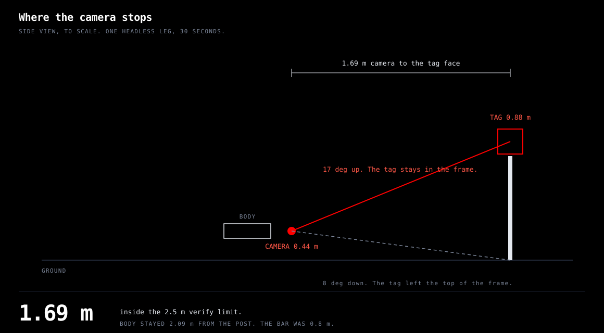

# Rupsha

**An autonomy stack for a ground rover. The body being built is a small Ackermann chassis:
one driven axle, a steering servo, a camera, an IMU, and GPS. A Raspberry Pi 5 does the
thinking. A custom ESP32 board owns the loop that must not stall. No number appears in this
repository without the measurement that produced it.**

[](#run-it) [](.claude/context/platform/chassis.md) [](.claude/context/platform/sim-and-hitl.md) [](#what-is-true-today) [](LICENSE)

**[Figures](docs/index.html)** · **[The Shift](docs/the-shift.md)** · **[Capability map](docs/capability-map.md)** · [Run it](#run-it) · [A marker leg](#a-marker-leg) · [The book](.claude/context/README.md)

### The name

**Rupsha** (রূপসা) is the river that flows past Khulna and continues south as the **Pasur**
(পশুর) — the river the **Port of Mongla** stands on, before it reaches the Bay of Bengal and the
Sundarbans. [Mongla](https://github.com/fh1m/mongla_ws) is the AUV stack this one grew out of;
Rupsha is upstream of it, on dry land, and carries the same water: the same fundamentals, a
different vehicle.

> **রূপসা** নদী খুলনা শহরের পাশ দিয়ে বয়ে দক্ষিণে **পশুর** নদী হয়ে গেছে — যে পশুরের তীরে
> **মোংলা বন্দর**, তারপর বঙ্গোপসাগর আর সুন্দরবন। [মোংলা](https://github.com/fh1m/mongla_ws) আমাদের
> ডুবোযান (AUV)-এর সফটওয়্যার; রূপসা তারই উজানে, ডাঙায় চলা রোভারের জন্য — একই নীতি, ভিন্ন যান।

<sub>Geography from [Rupsa River](https://en.wikipedia.org/wiki/Rupsa_River) and
[Port of Mongla](https://en.wikipedia.org/wiki/Port_of_Mongla).</sub>

---

## What is true today

Every claim here is in one of four states, and they are never blurred: **FIELD** (the real rover,
outdoors) · **BENCH** (real hardware on a desk, or the real code closing a loop against
SITL/Gazebo) · **BUILT** (code and tests, never closed a loop) · **BLOCKED**. Nothing is FIELD.
The chassis is being built. It has not been outdoors.

The body being built is the Ackermann chassis in
[chassis.md](.claude/context/platform/chassis.md). The Pi talks to
[the board contract](.claude/context/platform/firmware-contract.md). Gazebo stands in for the
ESP32 until the board exists.

| Capability | State | Evidence |
|---|---|---|
| Ackermann plant in Gazebo Harmonic: one driven axle, steer hinges, camera, IMU, GPS, no lidar | BENCH (Gazebo) | `test_gazebo_ackermann.py` |
| Board contract: speed, steer, ticks at 1873 per metre, quaternion, GPS, a dead link that zeros the command | BENCH (Gazebo) | the same test, scored on Gazebo's pose |

The rows below are the **previous body**: a six-wheel skid, a Pixhawk 2.4.8, and a Pi 4.
They are not measurements of this chassis.

| Capability | State | Evidence |
|---|---|---|
| Pixhawk 2.4.8 on ArduRover 4.7.2, baseline params audited clean | BENCH | `pytest -m board`: 6 pass on the real board |
| Board refuses to arm (compass uncalibrated); the reason reaches the caller | BENCH / **BLOCKED** | needs a person to rotate the board: `ros2 run rupsha_control compass_cal --reboot` |
| Companion-loss failsafe → HOLD (board acts at 3.5 s, seen at 3.6 s) | BENCH (SITL) | `test_sitl_scenarios.py` |
| GNSS goto, drive, turn, velocity streams | BENCH (SITL) | arrival checked against SIMSTATE |
| Gazebo 6WD lockstep: 1.00 m/s, heading held, `turn_to` without overshoot | BENCH (Gazebo) | `test_gazebo_lockstep.py`, checked against Gazebo's pose |
| Pi-in-the-loop square drive, 0.73 m truth closure, 11.5 % CPU on the Pi | BENCH | `tools/pil.sh` |
| Sim-on-Hardware: fits and boots on the Pixhawk, but its simulated IMUs never report healthy | **BLOCKED** | [record](.claude/context/platform/records/sim_on_hw_2026-10-21.json) |
| ArUco range in Gazebo: ~3 % long, reliable to 4.5 m, edge at 6 m, never at 8 m | BENCH (Gazebo) | `test_gazebo_aruco.py`, checked against Gazebo's pose |
| Whole stack on a marker leg: GNSS → search → approach → verify, camera 1.69 m from the tag | BENCH (Gazebo) | `test_gazebo_marker_leg.py`, one headless run ([B-32](.claude/context/BUGS.md)) |
| Autonomy executive: legs, stuck ladder, verification, detours | BUILT | 12 scenarios on a simulated-time fake board |
| ArUco posts (OpenCV 4.6 and 4.13), YOLO objects, shadow RI-EKF | BUILT | truth tests on rendered scenes and known trajectories |
| Anything on the ground, outdoors | BLOCKED | the chassis is being built; outdoors is still 0 |

Full map, every row's evidence: [`docs/capability-map.md`](docs/capability-map.md).
Every number and the run that produced it: [`.claude/context/measured-bars.md`](.claude/context/measured-bars.md).
The same figures, as the public page: [fh1m.github.io/rupsha_ws](https://fh1m.github.io/rupsha_ws/). Source is [`docs/`](docs/index.html).

<p align="center"></p>

---

## Who is this for

| If you are here to… | Start at |
|---|---|
| continue the work | [HANDOFF](.claude/context/HANDOFF.md), then the code it names |
| see whether a claim is real | [capability map](docs/capability-map.md), then the test in that row |
| run the stack in simulation | [Run it](#run-it), headless |
| understand why the Pi does not drive the motors | [The Shift](docs/the-shift.md) |
| read the chassis and the board contract | [chassis](.claude/context/platform/chassis.md), then [the contract](.claude/context/platform/firmware-contract.md) |
| touch the previous Pixhawk | [the board page](.claude/context/platform/ardurover-pixhawk.md). Compass calibration needs a person holding it |

---

## How the whole thing fits together

Two computers. The ESP32 closes the loop that must not stall: encoder, IMU, speed, steer,
and the stop. The Pi 5, with a Hailo-8 hat when it is on the bench, does the work that is
allowed to take 40 ms one frame and 80 ms the next. A slow frame must not be able to stall
the wheels. The sim does not pretend to be a Hailo. Vision in Gazebo is the camera.

<p align="center"></p>



ArduRover is not launched. The skid numbers stay in the ledger under the previous body.

Exactly one node touches the board. A bug in a mission cannot write a motor command. Bench
tools speak as sysid **246**. A tool that heartbeats as 245 and then exits latches the GCS
failsafe: the LED flashes yellow, mode HOLD, until reboot or until 245 speaks again.

| Package | What it is |
|---|---|
| `rupsha_interfaces` | `Move.action`, `RupshaState`, `AutonomyStatus` (generated), `Detection(s)` |
| `rupsha_control` | the board driver, the verb facade, the manager, `bringup_check`, `param_audit`, `compass_cal` |
| `rupsha_planner` | the executive, the mission DSL, the `rupsha` CLI |
| `rupsha_vision` | ArUco with pose and flip disambiguation, ONNX YOLO, a phase per autonomy state |
| `rupsha_localization` | a shadow right-invariant EKF that cross-checks EKF3; ExtNav is opt-in |
| `rupsha_sensors` | one table of sensors → drivers, topics, minimum rates |
| `rupsha_sim` | Gazebo model and worlds from seeded generators, SITL, the sim contract, Pi-in-the-loop |

### One verb, end to end

`goto_gnss` is the shape of all of them. The operator names an intent. The manager checks the
board. The Pixhawk drives. The result is one of seven outcomes, and a verb that did not happen
says so.



### The Pi goes quiet

<p align="center"></p>

A velocity command expires 3 s after the last one (`test_velocity_stream_drives_and_expires`).
A companion that vanishes is HOLD, measured at 3.6 s. Both are the board's, which is why a
stalled vision thread cannot leave the rover driving.

---

## The fundamentals

These are Mongla's, kept on purpose. Each one is a rule a test can fail.

1. **One node touches the board.** `rupsha_control`'s manager is the only MAVLink speaker;
   `fc/ardurover.py` is the only module that imports pymavlink, and a test enforces it.
2. **One action, verbs.** Everything the rover does is a verb on `/rupsha/move` — `goto_gnss`,
   `turn_to`, `vision_approach`, `search_spiral` — with a single result type. A mission is
   plain Python: `rupsha.goto_gnss(lat, lon)`.
3. **NaN means absent.** No reading defaults to zero. A detection with no age is not fresh.
4. **Reflexes on the board, thinking on the companion.** The ESP32 owns the speed loop, the
   steer, and the stop. The Pi sends speed and steer, and a heartbeat. A frame that is late
   must not be able to stall the wheels. On the previous body, ArduRover closed those loops
   and the Pi sent MAVLink intent.
5. **Truth tests.** A simulated run is scored on the simulator's ground truth, never on the
   estimate the rover steered by. In Gazebo that topic is `/sim/ground_truth/odometry`.

And from the [Missouri S&T Mars Rover Design Team](https://github.com/MissouriMRDT), whose
code was read and not copied:

6. **One manifest** ([`manifest/rupsha.yaml`](manifest/rupsha.yaml)) generates the messages,
   the constants and the command reference. Stale output fails CI. No code holds a topic name
   as a string.
7. **Legs, a state machine, verify before success.** The executive queues GNSS points, marker
   posts and objects. It will not call a leg done because the rover stopped nearby. A position
   leg averages GNSS. A marker leg has to see the tag, inside the standoff plus one metre,
   for most of a 1.5 s window.

The research those rules came from, with the files they were read in:
[sota](.claude/context/sota/README.md).

---

## A marker leg

This run is the **previous body**: the skid model and ArduRover. That launch is gone.
It is not a result for the Ackermann chassis. Post 3 of `flat_ci` carries a
20 cm ArUco tag. The executive is sent to a GNSS point 6 m short of it. From there:



Search does not hand over on one lucky frame at the decode edge. Three distinct frames, or it
drives in to 4 m of the estimate and looks again. A retry that already holds those three fixes
drives back to them. It does not throw the estimate away and spiral.

Inside 4.5 m the approach steers on the pixels. Farther out it hands the board a point in the
local frame. The board stops `WP_RADIUS` (1.0 m) short of any point it is given, so the point
is `standoff − 1.0` m from the tag and the board's own stop is the 1.5 m standoff.

Each fix uses the rover's pose **at the image's capture time**, interpolated across a 3 s
history, plus the camera's 0.33 m offset in the Gazebo model. A pose taken "now" while the
rover is pivoting puts a 7 m fix more than a metre off.

<p align="center"></p>

The one headless run of `test_gazebo_marker_leg.py` finished in 30 s. The executive's detail
was `all 1 legs complete`. Gazebo's pose put the camera 1.69 m from the tag face (the bar is
2.5 m) and the body never came closer than 2.09 m to the post centre (the bar is 0.8 m).

The camera used to look 8° down. At that pitch the tag's centre, 0.88 m up, sat on the top
edge of the frame by the time the rover was close, and the verify window stared at the pole.
It now looks 17° up, which puts that centre near the optical axis at the 1.5 m standoff.
After the change, the 3 m and 4.5 m range stations still see the tag in every frame and still
read about 3 % long ([measured bars §3](.claude/context/measured-bars.md#3-gazebo-harmonic--sitl-lockstep-rupsha_skid-flat_ci)).

---

## Run it

```bash
# build, lint, everything that is not Gazebo
sudo -u fh1m bash -lc 'cd /home/fh1m/tmp/rupsha_ws && source /opt/ros/jazzy/setup.bash && ./build_rupsha.sh && source install/setup.bash && /opt/rupsha-venv/bin/ruff check . && /opt/rupsha-venv/bin/python -m pytest -q -m "not gazebo"'

# the closed loops. Headless. The Gazebo window drops the sim to about 0.4× real time
# and is only for a person who wants to watch.
sudo -u fh1m bash -lc 'cd /home/fh1m/tmp/rupsha_ws && source /opt/ros/jazzy/setup.bash && source install/setup.bash && export GZ_VERSION=harmonic && /opt/rupsha-venv/bin/python -m pytest -q -m gazebo src/rupsha_sim'

# the Ackermann plant and the board contract. This is the default sim.
sudo -u fh1m bash -lc 'cd /home/fh1m/tmp/rupsha_ws && source /opt/ros/jazzy/setup.bash && source install/setup.bash && export GZ_VERSION=harmonic ROS_AUTOMATIC_DISCOVERY_RANGE=LOCALHOST && ros2 launch rupsha_sim sim.launch.py headless:=true'

```

The default launch forces localhost discovery. Multicast on this subnet does not reliably
join the controller manager to the robot description. A shell left on `SUBNET` will not see
these nodes.

With the previous Pixhawk on USB and nothing on the servo outputs:

```bash
ros2 run rupsha_control param_audit
ros2 run rupsha_control bringup_check --bench
pytest -m board src/rupsha_control
```

Do not arm with anything wired to the outputs. Do not open the bootloader port (its name
contains `-BL`). Compass calibration is `ros2 run rupsha_control compass_cal --reboot`, and
only while a person is holding the board.

The Pi is down. Do not SSH it, and do not run `tools/pil.sh`, until it is back.

---

## What stands in the way

| Block | What it waits on |
|---|---|
| Arming the real board | a person, for the onboard compass, and the safety switch |
| Pi-in-the-loop | the Pi 4 is powered off |
| Sim-on-Hardware | the simulated IMUs never report healthy; recorded, not to be re-flashed casually |
| Anything FIELD | the chassis on the ground, then a battery and a first outdoor run |
| RTK heading | two u-blox F9P receivers |

The order from here is in [ROADMAP](.claude/context/ROADMAP.md). The marker leg and the
`urc_autonomy` course were scored on the previous skid body. They wait until this hull's
contract is the one the executive speaks.

---

## Documents

- [`docs/index.html`](docs/index.html) — the figures, with the sentence each one is for
- [`docs/the-shift.md`](docs/the-shift.md) — reflexes on the board, thinking on the Pi
- [`docs/capability-map.md`](docs/capability-map.md) — every capability, its evidence, its state
- [`CLAUDE.md`](CLAUDE.md) — the vehicle, the traps, how to run
- [`.claude/context/README.md`](.claude/context/README.md) — the book, in reading order
- [`.claude/context/HANDOFF.md`](.claude/context/HANDOFF.md) — where the work is, for the next person
- [`.claude/context/measured-bars.md`](.claude/context/measured-bars.md) — every number
- [`.claude/context/sota/README.md`](.claude/context/sota/README.md) — what was read, and where
- [`.claude/context/BUGS.md`](.claude/context/BUGS.md) — the defect register, open and fixed

## Authors

Written by **Muhammad Fahim Faisal** ([fh1m.github.io](https://fh1m.github.io/)). See
[`AUTHORS.md`](AUTHORS.md). MIT licensed.
