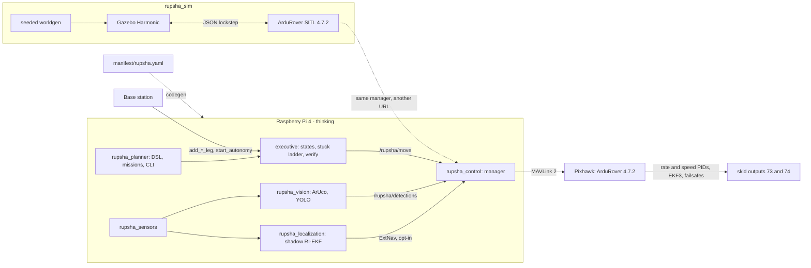

# Rupsha

**An autonomy stack for a ground rover — a Pixhawk that owns the reflexes, a Raspberry Pi that
does the thinking, one manifest that defines every verb, and a rule that no number appears in
this repository without the measurement that produced it.**

[](#run-it) [](CLAUDE.md#1-the-vehicle) [](.claude/context/platform/sim-and-hitl.md) [](#what-is-true-today) [](LICENSE)

**[The Shift](docs/the-shift.md)** · **[Capability map](docs/capability-map.md)** · [Run it](#run-it) · [Fundamentals](#the-fundamentals) · [Docs](#documents)

### The name

**Rupsha** (রূপসা) is the river that flows past Khulna and continues south as the **Pasur**
(পশুর) — the river the **Port of Mongla** stands on, before it reaches the Bay of Bengal and the
Sundarbans. [Mongla](https://github.com/fh1m/mongla_ws) is the AUV stack this one grew out of;
Rupsha is upstream of it, on dry land, and carries the same water: the same fundamentals, a
different vehicle.

> **রূপসা** নদী খুলনা শহরের পাশ দিয়ে বয়ে দক্ষিণে **পশুর** নদী হয়ে গেছে — যে পশুরের তীরে
> **মোংলা বন্দর**, তারপর বঙ্গোপসাগর আর সুন্দরবন। [মোংলা](https://github.com/fh1m/mongla_ws) আমাদের
> ডুবোযান (AUV)-এর সফটওয়্যার; রূপসা তারই উজানে, ডাঙায় চলা রোভারের জন্য — একই নীতি, ভিন্ন যান।

<sub>Geography from [Rupsa River](https://en.wikipedia.org/wiki/Rupsa_River) and
[Port of Mongla](https://en.wikipedia.org/wiki/Port_of_Mongla).</sub>

---

## What is true today

Every claim here is in one of four states, and they are never blurred: **FIELD** (the real rover,
outdoors) · **BENCH** (real hardware on a desk, or the real code closing a loop against
SITL/Gazebo) · **BUILT** (code and tests, never closed a loop) · **BLOCKED**. Nothing is FIELD:
the chassis does not exist yet.

| Capability | State | Evidence |
|---|---|---|
| Pixhawk 2.4.8 on ArduRover 4.7.2, baseline params audited clean | BENCH | `pytest -m board`: 6 pass on the real board |
| Board refuses to arm (compass uncalibrated); the reason reaches the caller | BENCH / **BLOCKED** | needs a person to rotate the board |
| Companion-loss failsafe → HOLD (board acts at 3.5 s, seen at 3.6 s) | BENCH (SITL) | `test_sitl_scenarios.py` |
| GNSS goto, drive, turn, velocity streams | BENCH (SITL) | arrival checked against SIMSTATE |
| Gazebo 6WD lockstep: 1.00 m/s, heading held, `turn_to` without overshoot | BENCH (Gazebo) | `test_gazebo_lockstep.py`, checked against Gazebo's pose |
| Pi-in-the-loop square drive, 0.73 m truth closure, 11.5 % CPU on the Pi | BENCH | `tools/pil.sh` |
| Sim-on-Hardware: fits and boots on the Pixhawk, but its simulated IMUs never report healthy | **BLOCKED** | [record](.claude/context/platform/records/sim_on_hw_2026-10-21.json) |
| ArUco range in Gazebo, rover driving itself to the post: ~3 % long, reach ~6 m for a 20 cm tag | BENCH (Gazebo) | `test_gazebo_aruco.py`, checked against Gazebo's pose |
| Autonomy executive: legs, stuck ladder, verification, detours | BUILT | 12 scenarios on a simulated-time fake board |
| ArUco posts (OpenCV 4.6 and 4.13), YOLO objects, shadow RI-EKF | BUILT | truth tests on rendered scenes and known trajectories |
| Anything on the ground, outdoors | BLOCKED | no chassis yet |

Full map with every row's evidence: [`docs/capability-map.md`](docs/capability-map.md).

---

## The fundamentals

These are Mongla's, kept on purpose:

1. **One node touches the board.** `rupsha_control`'s manager is the only MAVLink speaker;
   `fc/ardurover.py` is the only module that imports pymavlink, and a test enforces it.
2. **One action, verbs.** Everything the rover does is a verb on `/rupsha/move` — `goto_gnss`,
   `turn_to`, `vision_approach`, `search_spiral` — with a single result type. Mission code is
   plain Python over those verbs: `rupsha.goto_gnss(lat, lon)`.
3. **NaN means absent.** No reading defaults to zero. ABSENT is a verdict of its own.
4. **Reflexes on the board, thinking on the companion.** ArduRover closes the turn-rate and speed
   loops, mixes skid steering, follows S-curves, runs EKF3 and every failsafe. The Pi sends intent.
5. **Truth tests.** Simulated runs are checked against the simulator's ground truth, never against
   the estimate the rover navigated by.

And from the [Missouri S&T Mars Rover Design Team](https://github.com/MissouriMRDT), URC
champions, whose code we read end to end:

6. **One manifest** ([`manifest/rupsha.yaml`](manifest/rupsha.yaml)) generates the messages,
   the constants and the command reference. MRDT's `manifest.json` idea, made mechanical: stale
   output fails CI, and no code holds a topic name as a string.
7. **Legs are first-class** (`add_marker_leg`, `start_autonomy`), run by an explicit
   `AutonomyState` machine with a **stuck ladder** (reverse; +65° and reverse; −65° and reverse;
   STUCK) and **verify before success** (GNSS averaging, multi-frame tag confirmation).

---

## Architecture



| Package | What it is |
|---|---|
| `rupsha_interfaces` | `Move.action`, `RupshaState`, `AutonomyStatus` (generated), `Detection(s)` |
| `rupsha_control` | the board driver, the verb facade, the manager node, `bringup_check`, `param_audit` |
| `rupsha_planner` | the autonomy executive, the mission DSL, the `rupsha` CLI, missions |
| `rupsha_vision` | ArUco posts with IPPE pose and flip disambiguation, ONNX YOLO, phase scheduling |
| `rupsha_localization` | a shadow right-invariant EKF that cross-checks EKF3; opt-in ExtNav |
| `rupsha_sensors` | one table of sensors → drivers, topics, minimum rates; `sensors_check` |
| `rupsha_sim` | Gazebo worlds and model from seeded generators, SITL wrapper, sim contract, PIL |

---

## Run it

```bash
./build_rupsha.sh && source install/setup.bash
pytest                                                   # unit tests and repo guards
pytest -m "sitl or gazebo" src/rupsha_sim                # closed loops against simulators
ros2 launch rupsha_sim sim.launch.py world:=playpen      # Gazebo + SITL + the stack
ros2 run rupsha_planner mission square_drive             # in another terminal
```

On the rover: `ros2 launch rupsha_planner rupsha.launch.py`. Before that, with the Pixhawk on USB:
`ros2 run rupsha_control bringup_check --bench`.

---

## Documents

- [`CLAUDE.md`](CLAUDE.md) — the entry point: vehicle, board traps, rules, how to run
- [`docs/the-shift.md`](docs/the-shift.md) — why the work is split the way it is
- [`docs/capability-map.md`](docs/capability-map.md) — every capability, its evidence, its state
- [`.claude/context/README.md`](.claude/context/README.md) — the book: every document in reading order
- [`.claude/context/sota/README.md`](.claude/context/sota/README.md) — the research behind each choice, with sources

## Authors

Written by **Muhammad Fahim Faisal** ([fh1m.github.io](https://fh1m.github.io/)). See
[`AUTHORS.md`](AUTHORS.md). MIT licensed.
