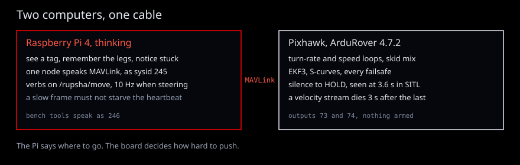

# The Shift — from a submarine to a rover, and where the thinking lives

*Written for a reader with no robotics background. Engineers can skip to §4.*

## 1. Two computers, two kinds of work

A robot that moves has to do two very different jobs at once.

The first is **reflex**: hundreds of times a second, read the gyroscope, compare how fast the
vehicle is turning with how fast it was told to turn, and nudge the motors. Miss a beat and the
vehicle wobbles; stall for half a second and it drives into something. This work is small, but it
must happen *on time, every time*.

The second is **thinking**: find the orange post in a camera image, decide which of three
waypoints comes next, notice that the wheels are spinning but the rover is not moving. This work
is large and irregular — a neural network may take 80 ms one frame and 140 ms the next — and it
is fine for it to be a little late, as long as it is never *wrong about being late*.

Rupsha gives each job to a computer built for it. A **custom ESP32 board** does the reflexes:
the encoder, the IMU, the speed loop, the steering servo, and the stop. A **Raspberry Pi 5**
does the thinking, with a Hailo-8 hat when that hat is on a bench. The sim does not pretend
to be a Hailo. One link joins them. The Pi sends a speed and a steer. The board sends ticks,
a rotation, and a GPS fix. If the Pi goes quiet, the board zeros the speed and centres the
steer. It does not keep driving a mission.

The previous computer was a Pixhawk running ArduRover, and a Pi 4. That split is still in the
repository, and its measurements are labelled as that body. It is not the machine being built.

## 2. What the previous board already knew how to do

ArduRover is fifteen years of other people's field time. On the previous body it:

- closes the **turn-rate** and **speed** loops (`ATC_STR_RAT_*`, `ATC_SPEED_*`);
- **mixes skid steering**: "go 1 m/s while turning 30°/s" becomes a left-wheel and a right-wheel
  command (`SERVO1_FUNCTION=73`, `SERVO3_FUNCTION=74`);
- **follows paths** with S-curves between GNSS waypoints;
- runs **EKF3**, the estimator that fuses the IMU, compass and GNSS into "where am I";
- owns **every failsafe**: lose the companion, lose the radio, lose the EKF — and it holds.

That was the right split for a flight controller we did not write. This chassis wants the
loop in firmware we do write, aimed at 200 Hz and not claimed until a scope shows it. The
thing that must not move onto the Pi is the same: a Linux frame that takes 80 ms must not be
able to stall the wheels. The Pi sends **intent** — a speed in millimetres per second and a
steer in radians — and the board decides the pulses.

When the Pi's heartbeat stops, the board does not wait for a person:

## 3. What the Pi adds

What ArduRover cannot do is *understand the world*. The Pi:

- **sees** — ArUco markers on posts, objects with a YOLO detector (`rupsha_vision`);
- **remembers a plan** — legs to visit, obstacles learned on the way (`rupsha_planner`);
- **notices trouble** — a rover that is commanded to move but is not moving is stuck; the
  executive runs a **stuck ladder** (reverse; turn 65° and reverse; turn the other way and
  reverse; give up and say so);
- **checks the board** — a second, independent estimate of where the rover is
  (`rupsha_localization`), which can only ever *advise*;
- **refuses honestly** — if the board will not arm, the reason it gave reaches the operator
  word for word.

## 4. The rules that make the split safe

1. **One node owns the board.** Every command goes through `rupsha_control`'s manager. Two
   programs talking MAVLink to one board is how a robot gets two contradicting orders.
2. **The Pi is a GCS the board watches.** The board is told the Pi's identity
   (`MAV_GCS_SYSID=245`) and that silence from it is an emergency (`FS_GCS_ENABLE=1`,
   `FS_GCS_TIMEOUT=2`, `FS_ACTION=2`). If the Pi crashes, the rover holds — 2 s to declare the
   failsafe plus `FS_TIMEOUT` 1.5 s to act; seen in SITL at 3.6 s. The Pi sends its heartbeat from its own thread so a slow camera frame can never
   starve it.
3. **Streams expire.** Velocity commands from the Pi are good for 3 s; a Pi that stops talking
   mid-turn does not leave the rover turning.
4. **Intent, not motor commands.** A `goto_gnss` is one message; the board's planner does the
   rest at no CPU cost to the Pi. Only vision-guided verbs stream at 10 Hz, because only they need
   the camera inside the loop.
5. **Nothing is assumed.** A value that was not received is NaN. A sensor that did not report is
   ABSENT, never PASS.

## 5. From Mongla to Rupsha

Mongla flies an underwater vehicle on a custom control board. Its lessons carried over intact —
one board owner, one action of verbs, NaN for absent, truth tests, measured bars — and the
vehicle-specific parts were replaced:

| | Mongla (AUV) | Rupsha (rover) |
|---|---|---|
| Reflex board | SROT board, firmware Hengla | ESP32, firmware not written yet. The Pixhawk was the previous board |
| Companion | Pi 5 + Hailo-8 | Pi 5 + Hailo-8, the same place. The Pi 4 was the previous companion |
| Position | downward camera, no GNSS underwater | encoder and heading between GPS fixes. The M8N is the outdoor fix |
| The hard part | depth hold, buoyancy, a camera in water | terrain, slip, getting stuck, long legs |
| Mission shape | RoboSub tasks | URC-style legs: GNSS points, ArUco posts, objects |

From the [Missouri S&T Mars Rover Design Team](https://github.com/MissouriMRDT) — URC
champions — came the rest: a single manifest that generates every message and constant, legs as
first-class commands, an explicit autonomy state machine with a stuck ladder, and verifying
arrival before declaring it.

## 6. What this does not claim

The chassis is being built. Nothing has been outdoors. The pictures are drawings. Every
result comes from the previous Pixhawk on a desk, from ArduRover's simulator, or from Gazebo,
and the page that lists them says which body it was. The first outdoor run will change some
of these numbers; when it does, the measurement wins.
